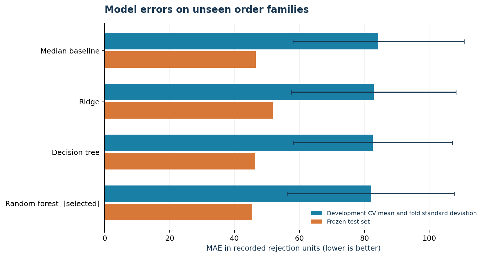
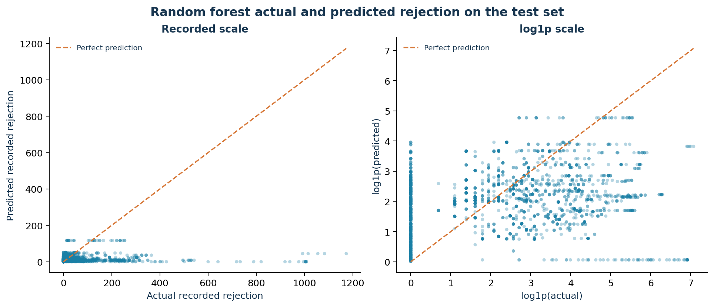
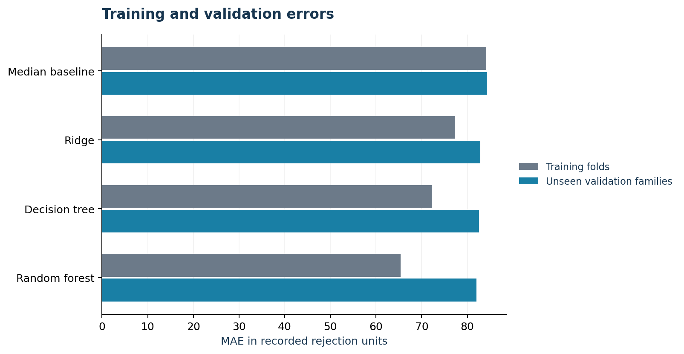

# Member 03 model results

Selected using development CV MAE: **Random forest**.

| Model | CV MAE | Test MAE | Test RMSE | Test R² |
| --- | --- | --- | --- | --- |
| Median baseline | 84.342 | 46.529 | 121.102 | -0.112 |
| Ridge | 82.835 | 51.808 | 126.477 | -0.213 |
| Decision tree | 82.597 | 46.321 | 121.518 | -0.120 |
| Random forest | 82.022 | 45.248 | 120.004 | -0.092 |

MAE and RMSE use the original recorded target scale. The physical unit still needs confirmation. CV scores were used for tuning; the test set was evaluated after selection was frozen.

The measured improvement over the median baseline is modest. Negative R² and the scatter plot show that the current inputs do not explain the large rejection amounts well. The model remains a research prototype.

Development: 3,365 rows. Test: 2,308 rows. Related development rows excluded to protect the inherited test set: 5,383. No order family crosses the development/test boundary.

The same five grouped folds compare 72 Ridge settings, 40 tree settings and 32 forest settings. Best parameters are in artifacts/best_parameters.json. Full candidate scores are in search_results/.

The source event definition, duplicate semantics, order-family relationships and target unit still need upstream validation. The supplied handover is used with one copy per identical exported row. Production outcome columns are excluded from model inputs.
